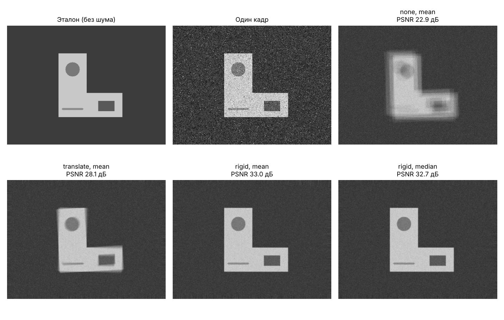
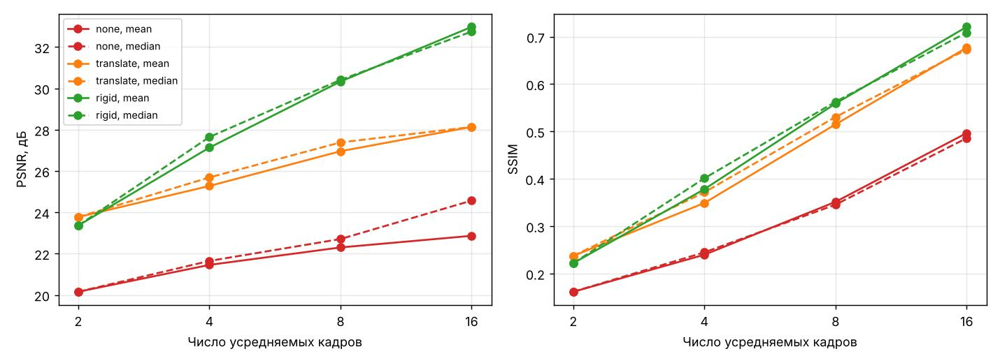
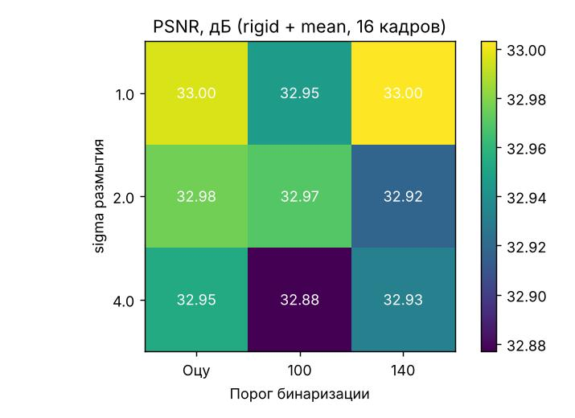
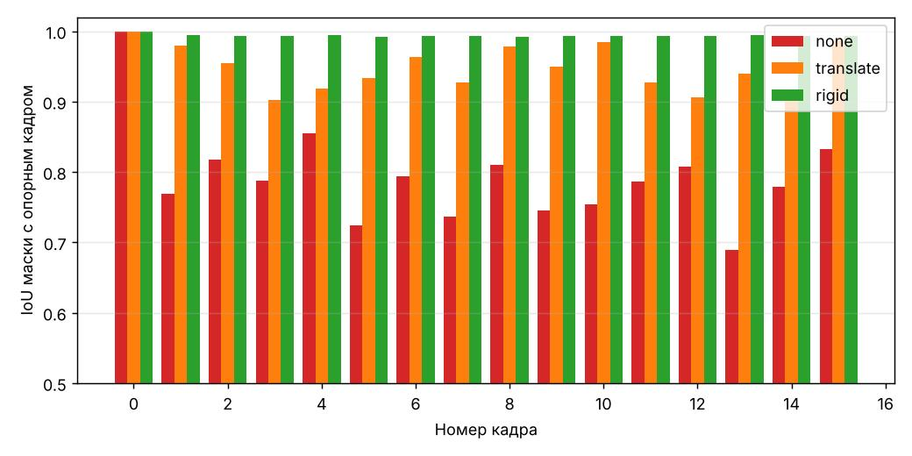
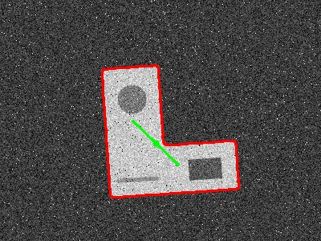

# Лабораторная работа №18. Вариант 20

**Цифровая обработка сигналов на Python: обработка изображений.**
Серия кадров объекта: пакетная обработка, выравнивание по контуру, усреднение для подавления шума.

Автор: *ФИО, группа*

## Идея

На каждом кадре серии объект немного смещён и повёрнут, а изображение зашумлено.
Если просто усреднить кадры, объект расплывается. Поэтому программа:

1. выделяет объект на каждом кадре (размытие, порог Оцу, морфология, поиск контура);
2. по контуру считает центр масс и ориентацию (через моменты контура);
3. совмещает все кадры с первым (опорным) аффинным преобразованием;
4. усредняет выровненные кадры (среднее или медиана), и шум падает примерно в корень из N раз.

## Установка и запуск

Нужен Python 3.10 или новее.

```bash
python -m venv venv
venv\Scripts\activate           # Windows
source venv/bin/activate        # Linux/Mac
pip install -r requirements.txt
```

Создать тестовую серию (16 кадров, фиксированный seed, эталон без шума):

```bash
python generate_data.py
```

Обработать серию одной командой:

```bash
python main.py --input images --output results --method rigid --combine mean --reference reference/clean.png
```

Провести все эксперименты (CSV и графики для отчёта в `results/experiments`):

```bash
python experiments.py
```

Тесты:

```bash
python -m unittest discover tests
```

### Параметры `main.py`

| Параметр | Значение по умолчанию | Описание |
|----------|-----------------------|----------|
| `--input` | обязательный | каталог с кадрами (png, jpg, bmp, tif) |
| `--output` | `results` | каталог для результатов |
| `--method` | `rigid` | выравнивание: `none`, `translate` (сдвиг), `rigid` (сдвиг и поворот) |
| `--combine` | `mean` | объединение кадров: `mean` или `median` |
| `--sigma` | `2.0` | сигма размытия перед поиском контура |
| `--threshold` | `0` | порог бинаризации (0 - метод Оцу) |
| `--max-frames` | все | использовать только первые N кадров |
| `--reference` | нет | эталон без шума для расчёта MSE, PSNR, SSIM |

Коды возврата: `0` - успех, `1` - ошибка обработки (нет каталога, пустой каталог, повреждённый файл,
контур не найден и т.п.), `2` - недопустимое значение параметра.

## Что сохраняется

| Путь | Содержимое |
|------|------------|
| `results/original/<кадр>_original.png` | исходные кадры |
| `results/masks/<кадр>_mask.png` | маски объекта |
| `results/contours/<кадр>_contour.jpg` | кадр с контуром, центром масс и осью объекта |
| `results/aligned/<кадр>_aligned.png` | кадры после выравнивания |
| `results/result_<метод>_<объединение>.png` | итоговое изображение |
| `results/metrics.csv` | имя серии, метод, параметры, MSE, PSNR, SSIM, шум на фоне, IoU, время |

## Структура проекта

| Файл | Назначение |
|------|------------|
| `main.py` | интерфейс командной строки (argparse), запись результатов и метрик |
| `io_utils.py` | чтение и запись изображений (работает и с русскими путями), CSV |
| `processing.py` | поиск контура, выравнивание, усреднение, конвейер `process_series` |
| `metrics.py` | MSE, PSNR, SSIM, оценка шума на фоне |
| `generate_data.py` | генератор тестовой серии (сдвиги, повороты, гауссов и импульсный шум) |
| `experiments.py` | эксперименты с разными параметрами, графики |
| `tests/` | модульные тесты (`unittest`) |
| `images/`, `reference/` | тестовая серия и эталон |

## Результаты экспериментов

Серия из 16 синтетических кадров: гауссов шум (сигма 25), 1% импульсного шума, сдвиги до 12 пикселей,
повороты до 4 градусов. Метрики считаются относительно эталона без шума.

| Метод | Объединение | PSNR, дБ | SSIM | IoU масок |
|-------|-------------|----------|------|-----------|
| один кадр | - | 19.01 | 0.117 | - |
| none (без выравнивания) | mean | 22.86 | 0.497 | 0.793 |
| translate (сдвиг) | mean | 28.14 | 0.677 | 0.948 |
| rigid (сдвиг и поворот) | mean | **32.98** | **0.721** | **0.994** |
| rigid (сдвиг и поворот) | median | 32.75 | 0.709 | 0.994 |

Выводы:

- Выравнивание по контуру критично: без него усреднение даёт размытый объект, а выигрыш в PSNR в 3-4 раза меньше (3.9 дБ против 14.0 дБ).
- Одного сдвига недостаточно, остаётся размытие из-за поворотов; метод `rigid` убирает его.
- Чем больше кадров, тем лучше результат (графики `psnr_ssim_vs_frames.jpg`).
- Параметры `--sigma` (1, 2, 4) и `--threshold` (Оцу, 100, 140) почти не влияют на качество
  на этих данных: контраст объекта высокий (`params_sigma_threshold.jpg`).
- Среднее лучше медианы для гауссова шума, медиана полезнее при сильных выбросах и без выравнивания.

### Графики







## Ограничения

- Кадры обрабатываются в оттенках серого.
- Ориентация объекта определяется по моментам контура с точностью до 180 градусов, поэтому поворот
  между кадрами должен быть небольшим (до 90 градусов), а объект не должен быть симметричным
  (круг или квадрат не подойдут).
- Объект должен заметно отличаться по яркости от фона и занимать один основной контур.
- Свои фотографии: положите кадры одного размера в отдельный каталог и запустите `main.py --input <каталог>`.
  Без `--reference` метрики PSNR и SSIM не считаются, но шум на фоне и IoU считаются всегда.
